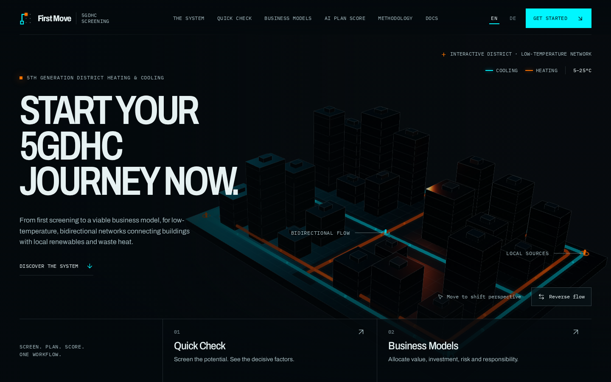

<div align="center">


# First Move

**Start your 5GDHC journey now.**

From a first screening to a viable business model — for the low-temperature,
bidirectional heating and cooling networks that connect buildings with local
renewables and waste heat.

[**Open First Move →**](https://www.firstmove.energy) &nbsp;·&nbsp; English &nbsp;·&nbsp; Deutsch



</div>

## What you can do

- **Quick Check** — describe your area, its buildings and the planned supply, and get a three-level screening result with the decisive factors behind it. Every number opens a "How we calculate" with its equations.
- **Business Plan** — work through the opportunity, the business logic and a reality check, step by step, and leave with a document you can hand to decision-makers.
- **AI Plan Score** — have your plan read the way an evaluator would: seven dimensions, named strengths and gaps, every source linked. Bring your own key; your plan never touches our servers.
- **Ask by email** — write to [agent@mail.firstmove.energy](mailto:agent@mail.firstmove.energy) and the email agent walks you through your own screening. A person answers at [human@mail.firstmove.energy](mailto:human@mail.firstmove.energy).

## Your data stays yours

No account, no backend, no database. Your projects live in your browser's storage and travel as files you export and import. The site's security policy blocks project data from leaving your machine — the [Privacy Policy](https://www.firstmove.energy/en/privacy) says it plainly.

## Made for the energy transition

For municipalities, energy agencies, utilities and planners who need a serious first answer in minutes, not a study in months. The screening follows the published AQC methodology, equation for equation — the [docs](https://www.firstmove.energy/en/docs) show every one of them.

## For developers

<details>
<summary><b>Run it yourself</b> — Node.js 20.9+ and pnpm</summary>

```bash
pnpm install
pnpm dev
```

| Command | What it does |
|---|---|
| `pnpm dev` | Development server |
| `pnpm build` · `pnpm start` | Production build and server |
| `pnpm lint` · `pnpm typecheck` | ESLint · route types and `tsc` |
| `pnpm test` · `pnpm test:e2e` | Vitest unit tests · Playwright end-to-end |

Requirements, equations, design tokens and the build log live in [`docs/`](docs/CLAUDE.md). Vulnerabilities: please report them privately, as [SECURITY.md](SECURITY.md) describes.

</details>

## License

[Apache License 2.0](LICENSE) for code and documentation; attribution and third-party notices in [NOTICE](NOTICE). The name "First Move" is a trade name the licence does not grant.
