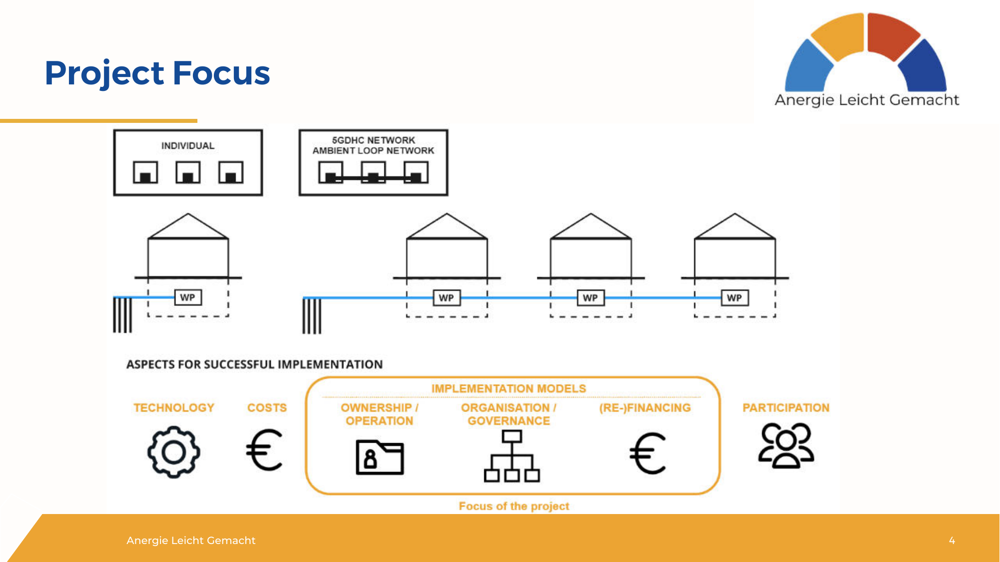

# Project Focus

*[Image: diagram. Labels as on the slide:]*

- INDIVIDUAL (one building, WP)
- 5GDHC NETWORK / AMBIENT LOOP NETWORK (three buildings, each WP, on one line)
- ASPECTS FOR SUCCESSFUL IMPLEMENTATION: TECHNOLOGY · COSTS · IMPLEMENTATION MODELS [OWNERSHIP / OPERATION · ORGANISATION / GOVERNANCE · (RE-)FINANCING] · PARTICIPATION
- Under IMPLEMENTATION MODELS: "Focus of the project"
