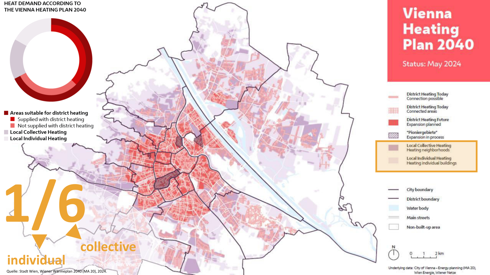

# Heat Demand According to the Vienna Heating Plan 2040

*[Image: map + ring chart. Labels as on the slide:]*

- Title: HEAT DEMAND ACCORDING TO THE VIENNA HEATING PLAN 2040
- Ring chart legend: Areas suitable for district heating (Supplied with district heating · Not supplied with district heating) · Local Collective Heating · Local Individual Heating
- Overlay: **1/6**, arrows to "individual" and "collective"
- Map: Vienna Heating Plan 2040, Status: May 2024 (legend: District Heating Today, Connection possible · District Heating Today, Connected areas · District Heating Future, Expansion planned · "Pioniergebiete", Expansion in process · Local Collective Heating, Heating neighborhoods · Local Individual Heating, Heating individual buildings)

Quelle: Stadt Wien, Wiener Wärmeplan 2040 (MA 20), 2024.
